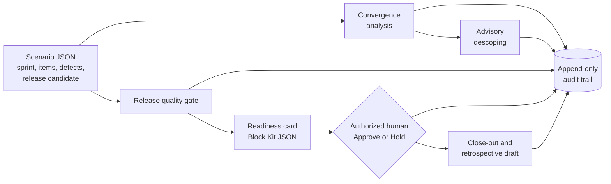
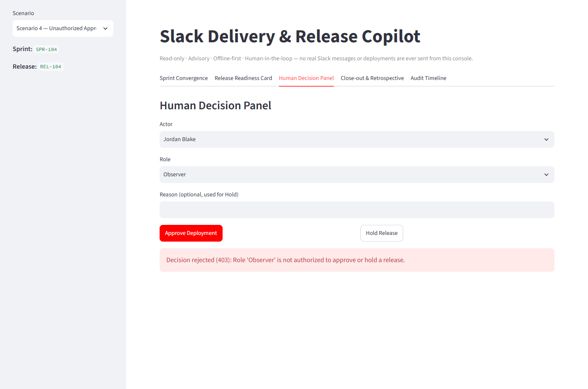

# Slack Delivery & Release Copilot

**Category: Project Planning & Delivery**

A local, offline proof of concept that helps a software team plan and monitor the last stretch of a
sprint: how likely the sprint is to land, what could be safely deferred, whether a release candidate
has the evidence it needs, and who signed off on shipping it. Results are presented as a simulated
Slack workflow and recorded in an audit trail.

## What it does and why it is useful

Near the end of a sprint, teams make the same three calls under time pressure: what to descope,
whether a release is safe, and who gets to say "go". These calls are often made informally, with
no consistent evidence or record. This project turns sprint and release data into:

- **Delivery monitoring** — a 0–100 convergence score, a risk level, at-risk items, and a carryover
  forecast.
- **Risk visibility** — advisory descoping recommendations with reasons and confidence values.
  Nothing is changed automatically.
- **Release readiness** — an 11-check quality gate (defects, QA, Definition of Done, code review,
  tests, dependencies, release notes, rollback, monitoring) and a Slack Block Kit-style readiness card.
- **Human sign-off** — only a registered Tech Lead or QA Lead can approve or hold a release. Every
  attempt, accepted or rejected, is logged.
- **Close-out support** — Say/Do Ratio, delivery counts, lessons, and a retrospective draft.

All scores and statuses come from plain, deterministic Python rules. An optional LLM can only reword
the opening paragraph of the retrospective draft.

## How it works



A FastAPI backend runs the rules against synthetic scenario files and stores gate results,
decisions, and audit events in SQLite. A Streamlit console calls the API and displays the results.
Nothing is posted to Slack and nothing is deployed.


*Application screenshot (local demo, synthetic data): a convergence score of 49.7 sets the risk to
High, and the descoping recommendations are shown as advisory only.*


*Application screenshot (local demo, synthetic data): an Observer tries to approve a release that is
ready for approval. The API rejects the attempt with HTTP 403 and records it in the audit trail.*

## Quick start

Requires Python 3.12+.

```bash
python -m venv .venv
# Windows: .venv\Scripts\activate   |   macOS/Linux: source .venv/bin/activate
pip install -r requirements.txt
python scripts/seed_demo.py            # create the SQLite schema and validate scenarios

uvicorn app.main:app --reload          # terminal 1 — API at http://localhost:8000 (Swagger: /docs)
streamlit run demo/streamlit_app.py    # terminal 2 — demo UI at http://localhost:8501
```

Or with Docker:

```bash
docker compose up --build              # API on :8000, demo UI on :8501
```

Tests and checks: `pytest -q`, `ruff check .`, `mypy app`.

## Limitations and human review

- This is a **proof of concept with synthetic data only**. There is no live Slack, CI/CD, or
  project-management tool integration.
- **The API has no authentication.** Identity and roles are simulated with each scenario's actor
  list, so approval authority is demonstrated, not enforced.
- Every output is **advisory**. People must review descoping recommendations, gate results, and
  retrospective drafts, and decide what to do with them. The system never changes scope, closes work,
  or deploys anything.
- The audit trail is append-only only at the application level, and SQLite is single-node.

## Documentation

- [Project Overview](docs/PROJECT_OVERVIEW.md): the problem, purpose, capabilities, workflow, and a worked example
- [Architecture](docs/ARCHITECTURE.md): components, data flow, decision rules, and integration status
- [Demo and Operations](docs/DEMO_AND_OPERATIONS.md): setup, configuration, demo scenarios, and troubleshooting
- [Governance and Validation](docs/GOVERNANCE_AND_VALIDATION.md): human oversight, security, testing, limitations, and future work

## Author

Oren Salmi — portfolio project, third leg of the ClickUp / Monday / Slack SDLC governance
triangle.
