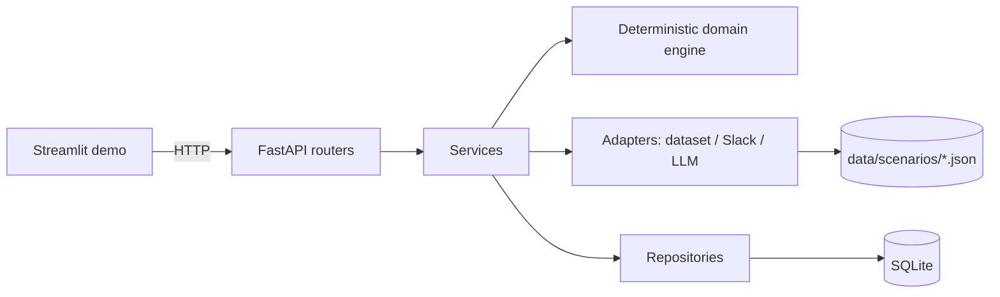

# Architecture

## Component Boundaries

```
app/
├── domain/        Pure deterministic rules. No framework imports, no I/O.
│                   convergence.py, descoping.py, gate.py, closeout.py
├── schemas/        Pydantic models: dataset input, enums, API request/response shapes
├── adapters/        The only layer allowed to touch the outside world
│   ├── dataset_adapter.py   Local JSON scenario loader + validator
│   ├── slack_adapter.py     Block Kit builder + MockSlackAdapter (never sends over the network)
│   └── llm/                  LLMAdapter interface, MockLLMAdapter (default), OpenAICompatibleLLMAdapter (opt-in)
├── repositories/    SQLAlchemy persistence: audit, decisions, gate evaluations, close-out reports
├── models/          SQLAlchemy ORM table definitions
├── services/        Orchestration: calls domain + adapters + repositories, writes audit events
├── api/              FastAPI routers — thin, no business logic
└── main.py            App assembly, middleware, global error handlers

demo/streamlit_app.py   Thin HTTP client over the API — no business logic of its own
```

Dependency direction is strictly one-way: `api` → `services` → `domain` / `adapters` /
`repositories`. `domain/` never imports from `api`, `services`, `adapters`, or `repositories` —
it is pure functions over Pydantic models, which is what makes it unit-testable without a
database or an HTTP layer.



## Deterministic Engine

`app/domain/` implements every business-critical calculation as plain, documented Python:
convergence scoring, risk classification, descoping classification, the release gate, and Say/Do
Ratio / close-out math. These functions take a validated `ScenarioDataset` and return a typed
result — no side effects, no I/O, fully reproducible for the same input. Full rule references:
[`CONVERGENCE_AND_DESCOPING.md`](CONVERGENCE_AND_DESCOPING.md) and
[`RELEASE_GATE_RULES.md`](RELEASE_GATE_RULES.md).

## LLM Explanation Layer

`app/adapters/llm/` defines one interface (`LLMAdapter.explain(kind, context)`) with two
implementations: `MockLLMAdapter` (default, offline, templated, deterministic) and
`OpenAICompatibleLLMAdapter` (opt-in, calls a configured chat-completions endpoint with a system
prompt that forbids inventing facts or changing values). `services/llm_explanation_service.py`
wraps every call: on any failure or invalid output it falls back to the mock adapter, logs an
`llm_fallback_used` audit event, and returns a guaranteed-usable string. The deterministic
workflow result is computed independently and is never gated on this call succeeding.

## Adapter Pattern

Every external-world touchpoint sits behind an adapter so the POC can later swap in a real
implementation without touching `domain/` or `services/`:

| Adapter | Implemented | Notes |
|---|---|---|
| Local JSON dataset | Yes | `LocalDatasetAdapter` — the only dataset source |
| Mock Slack | Yes | Builds Block Kit JSON; `send()` never performs a network call |
| Mock LLM | Yes | Default; fully offline and deterministic |
| OpenAI-compatible LLM | Yes (opt-in) | Disabled unless `LLM_MODE=openai_compatible` and configured |
| Real Slack API | Documented only | See `docs/LIMITATIONS_AND_ROADMAP.md` |
| PM-tool (Monday/ClickUp) | Documented only | See `docs/LIMITATIONS_AND_ROADMAP.md` |
| CI/CD adapter | Documented only | See `docs/LIMITATIONS_AND_ROADMAP.md` |

## API

FastAPI routers in `app/api/` are intentionally thin: they resolve a scenario via the dataset
adapter, call a service function, and return its typed Pydantic result. All validation errors,
authorization failures, and state-machine violations are raised as typed `CopilotError`
subclasses (`app/core/errors.py`) and translated to HTTP responses by a single global exception
handler in `main.py` — no endpoint leaks a raw stack trace.

## SQLite Persistence

Four tables (`app/models/orm.py`): `gate_evaluations`, `human_decisions`, `audit_events`,
`closeout_reports`. Scenario data itself is **not** persisted — it is always read fresh from
`data/scenarios/*.json` on each request, so there is nothing to desynchronize between the source
data and the database. `human_decisions` and `audit_events` are insert-only at the application
layer: no repository function updates or deletes a row in either table.

## Streamlit Demo

`demo/streamlit_app.py` talks to the API exclusively over HTTP (`httpx`) and renders whatever the
API returns, including rejections — it never simulates success locally when the backend rejects
an action. This keeps the UI provably consistent with the governance rules enforced server-side.

## Audit Flow

Every service function that performs a consequential action (dataset load, convergence analysis,
descoping generation, gate evaluation, approval attempt, close-out) calls
`app/repositories/audit_repo.append_event(...)` before returning. See
[`AUDITABILITY.md`](AUDITABILITY.md) for the full event catalog and guarantees.
