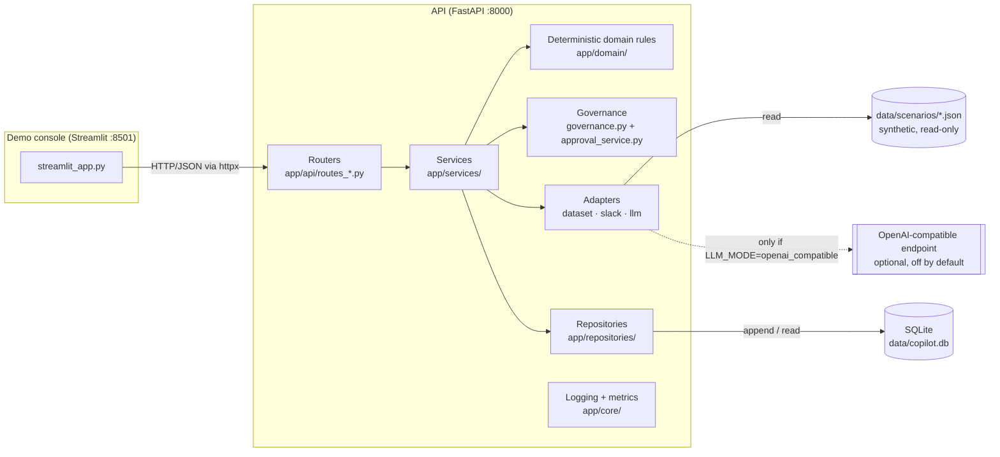
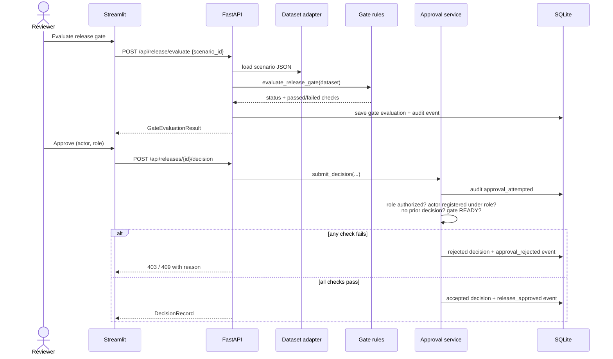

# Architecture

[← Back to README](../README.md)

## Overview

The project is a single Python codebase with two runtime processes:

- **API** (`app/`): a FastAPI service that loads scenario data, runs the deterministic rules,
  enforces the approval rules, and persists results to SQLite.
- **Demo console** (`demo/streamlit_app.py`): a thin Streamlit client. It has no business logic of
  its own. Every number and status it shows comes from an API response, and API rejections are
  displayed as rejections.

## Components

| Layer | Location | Responsibility |
|---|---|---|
| Entry point | `app/main.py` | Creates the FastAPI app, initializes the DB schema on startup, adds an `X-Correlation-ID` middleware, and registers error handlers that return safe messages only |
| Configuration | `app/core/config.py` | Uses `pydantic-settings` to read environment variables or `.env`. Defaults are fully offline |
| Routers | `app/api/routes_*.py` | HTTP endpoints for health, scenarios, convergence, release, sprints, and audit |
| Domain rules | `app/domain/convergence.py`, `descoping.py`, `gate.py`, `closeout.py` | Pure functions with no I/O or framework code. All scoring and gate logic lives here |
| Services | `app/services/` | Orchestrate the domain rules, persistence, audit events, and metrics. They also hold the approval state machine and the LLM fallback |
| Governance | `app/services/governance.py` | The single source of truth for who may decide: `AUTHORIZED_DECISION_ROLES = {Tech Lead, QA Lead}` |
| Adapters | `app/adapters/` | `LocalDatasetAdapter` (JSON files), the Slack Block Kit builder, and the LLM adapters (mock and OpenAI-compatible) |
| Persistence | `app/models/orm.py`, `app/repositories/` | SQLAlchemy models and append-style repositories |
| Observability | `app/core/logging.py`, `app/core/metrics.py` | JSON logs with correlation IDs, and Prometheus counters |
| Scripts | `scripts/` | `seed_demo.py` (create schema, validate scenarios), `reset_demo.py` (drop and recreate tables), `export_local_ca_cert.ps1` (Docker build helper) |

## Technologies

All versions are pinned in `requirements.txt`. Requires Python 3.12+.

| Purpose | Technology |
|---|---|
| API | FastAPI 0.115, Uvicorn |
| Validation and settings | Pydantic 2, pydantic-settings |
| Persistence | SQLAlchemy 2 with SQLite |
| Demo UI | Streamlit 1.41 |
| HTTP client | httpx (UI → API, and the optional LLM adapter) |
| Metrics | prometheus-client |
| Quality | pytest, pytest-cov, ruff, mypy |
| Packaging | Dockerfile (`python:3.12-slim`, non-root user) and `docker-compose.yml` |

## Data model

### Input: scenario datasets (read-only)

Each file in `data/scenarios/` is validated against `ScenarioDataset` (`app/schemas/dataset.py`):

- `sprint`: id, name, goal, start and end dates
- `work_items[]`: priority, business value, status, code review status, QA status, Definition of
  Done checklist, remaining hours, blocking dependencies, `required_for_sprint_goal`, `committed`,
  and `final_disposition` (Pending, Delivered, Descoped, or Carried Over, as recorded by a human)
- `defects[]`: severity (Blocker, Critical, Major, Minor), status, linked work item, blocker category
- `release_candidate`: version, tests passed, release notes, rollback plan and owner, monitoring
  plan, unresolved mandatory dependencies
- `authorized_actors[]`: name and role. **This list is the simulated identity source.**
- `historical_sprints[]`: used to detect repeated blocker categories
- `simulated_now`: a fixed "current time", which keeps every result reproducible
- `force_llm_failure`: a test flag that simulates an LLM outage

Scenarios are read fresh from disk on every request. They are never written to the database.

### Stored records (SQLite)

| Table | Contents | Write pattern |
|---|---|---|
| `gate_evaluations` | Each gate result (full JSON payload) | A new row for every evaluation |
| `human_decisions` | Every Approve/Hold attempt, with `accepted` and `rejection_reason` | Append only |
| `audit_events` | Event type, actor, role, sprint, release, states, reason, outcome, correlation ID | Append only, through a single write function |
| `closeout_reports` | Close-out report payloads | A new row for every generation |

Audit event types: `dataset_loaded`, `convergence_analysis_completed`,
`descoping_recommendation_generated`, `release_gate_evaluated`, `approval_attempted`,
`approval_rejected`, `release_approved`, `release_held`, `closeout_generated`, `llm_fallback_used`.

## API endpoints

| Method and path | Purpose | Writes |
|---|---|---|
| `GET /` | Service description | — |
| `GET /health`, `GET /ready` | Liveness check, and readiness check including the DB | — |
| `GET /metrics` | Prometheus counters | — |
| `GET /api/scenarios`, `GET /api/scenarios/{scenario_id}` | List scenarios or return one in full | — |
| `POST /api/convergence/analyze` | Convergence analysis | Audit events |
| `POST /api/convergence/descope` | Convergence plus descoping recommendations | Audit events |
| `POST /api/release/evaluate` | Release gate evaluation | Gate record and audit event |
| `GET /api/releases/{release_id}/readiness-card` | Readiness card and Block Kit JSON. Evaluates the gate first if no evaluation is on record | Possibly a gate record |
| `POST /api/releases/{release_id}/decision` | Approve or Hold (`actor`, `role`, `decision`, `reason`) | Decision record and audit events |
| `POST /api/sprints/{sprint_id}/close-out` | Close-out report | Report record and audit event |
| `POST /api/sprints/{sprint_id}/retrospective` | Close-out plus retrospective draft | Report record and audit events |
| `GET /api/audit`, `GET /api/audit/{release_id}` | Audit timeline, newest first | — |

POST bodies identify the data by `scenario_id`. The `sprint_id` path segment is part of the URL but
is not used to choose the data. Interactive documentation is at `/docs` (Swagger) and `/redoc`.

Error mapping (`app/core/errors.py`): not found → 404, invalid scenario file → 422, unauthorized
role or actor → 403, gate not ready, missing evidence, or duplicate decision → 409, anything
unexpected → 500 with a generic message.

## Data flow

The sequence below shows a typical review: evaluate the gate, then submit a decision.

## Decision rules

All thresholds are constants in `app/domain/`.

### Convergence (`convergence.py`)

1. For each committed item, a completion ratio is set from its status: Done 1.0, In QA 0.85, In Code
   Review 0.6, In Progress 0.35, Not Started 0.05, Blocked 0.0.
2. For items that are not Done, the ratio is halved for each of these that applies:
   - remaining hours exceed 80% of the sprint hours left
   - the item has unresolved blocking dependencies
   - the item is linked to an open Blocker or Critical defect
3. The score is the weighted average of these ratios × 100. The weight is the priority weight
   (Critical 4, High 3, Medium 2, Low 1) × the business value weight (High 3, Medium 2, Low 1).
4. Risk level: ≥ 80 Low, ≥ 60 Medium, ≥ 40 High, below 40 Critical.
5. An item is **at risk** below a ratio of 0.6, and **forecast to carry over** below 0.5.

### Descoping (`descoping.py`)

Descoping is triggered when 48 hours or less remain, or when the risk level is High or Critical.
Recommendations are produced in either case. Per item:

| Condition | Recommendation |
|---|---|
| Status is Done | Completed |
| Required for the sprint goal and (linked to an open Blocker/Critical defect, or blocked/dependency-blocked with a ratio below 0.5) | Must Hold |
| Required for the sprint goal | Protect |
| Low or medium priority, low or medium value, and not started or in progress | Candidate for Descoping |
| Blocked/dependency-blocked with a ratio below 0.5 and not goal-critical | Candidate for Descoping |
| Anything else | Needs Human Review |

Every recommendation except Completed is flagged `human_decision_required`.

### Release gate (`gate.py`)

Eleven checks in three categories. The highest-precedence failure decides the status:

| Category | Checks | Status if any fail |
|---|---|---|
| `blocking_defect` | No open Blocker defects. No open Critical defects | `HOLD_REQUIRED` |
| `hard_blocking` | QA passed for sprint-goal items. DoD complete for sprint-goal items. Code review approved for committed items. Release candidate tests passed. No unresolved mandatory dependency | `NOT_READY` |
| `evidence` | Release notes. Rollback plan. Rollback owner. Monitoring plan | `INSUFFICIENT_EVIDENCE` |
| (all pass) | — | `READY_FOR_HUMAN_APPROVAL` |

### Close-out (`closeout.py`)

**Say/Do Ratio** = committed items with `final_disposition = Delivered` ÷ all committed items ×
100. Descoped items stay in the denominator, so descoping does not inflate the ratio. Lessons are
added by rule: ratio below 70%, sprint goal not protected, carryover present, or blocker categories
repeated from `historical_sprints`.

## Integration status

| Integration | Status | What actually exists |
|---|---|---|
| Sprint and release data | **Implemented (local files only)** | `LocalDatasetAdapter` reads `data/scenarios/*.json`. No project-management tool connection |
| Slack | **Message format only, never sent** | `build_readiness_card_block_kit()` builds a Block Kit-compatible payload, which is returned by the API and shown as collapsible JSON in the demo. `MockSlackAdapter.send()` exists but makes no network call, and no endpoint calls it. The payload's Approve/Hold buttons are not wired to anything. Decisions are made through the API or the Streamlit panel |
| LLM: mock | **Implemented, default** | `MockLLMAdapter` returns deterministic template text. Only the retrospective introduction uses the LLM layer |
| LLM: OpenAI-compatible | **Optional, opt-in** | Enabled with `LLM_MODE=openai_compatible` plus a base URL, API key, and model. Any error or empty output falls back to the mock and is audited. Calls to a real endpoint were not exercised for this documentation |
| Identity and authentication | **Simulated** | Roles come from each scenario's `authorized_actors`. The API itself has no authentication |
| CI/CD | **Not implemented** | Test results are a boolean field in the scenario data |
| Monitoring | **Endpoint only** | `/metrics` exposes counters in Prometheus format. No Prometheus or Grafana setup is included |

## Deployment shape

- **Local:** two processes (`uvicorn` and `streamlit`). SQLite file at `./data/copilot.db`.
- **Docker Compose:** both services use the same image. `api` has a healthcheck on `/health`, and
  `demo` starts only after `api` is healthy and reaches it at `http://api:8000`. The SQLite file
  lives on the named volume `copilot-data`. The container runs as a non-root user (`appuser`).

There is no production deployment, cloud infrastructure, or multi-node setup.

[← Back to README](../README.md)
