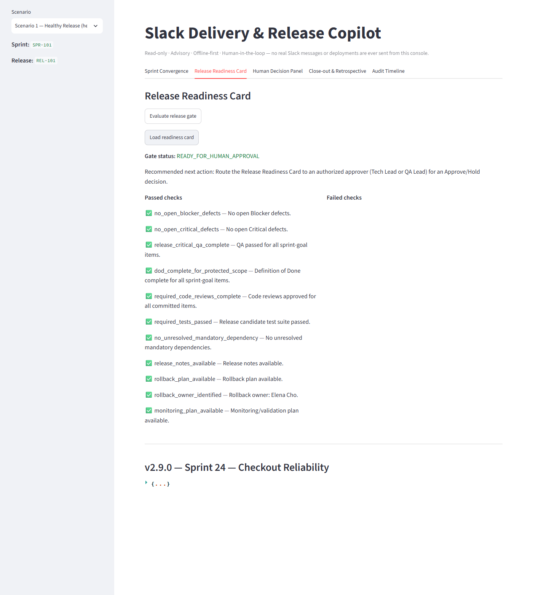
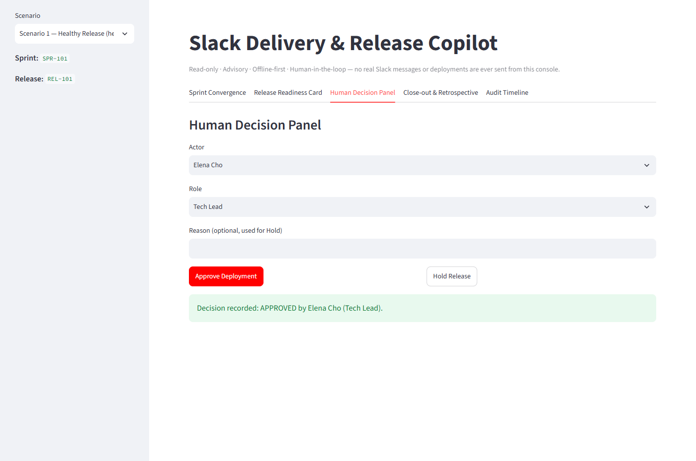
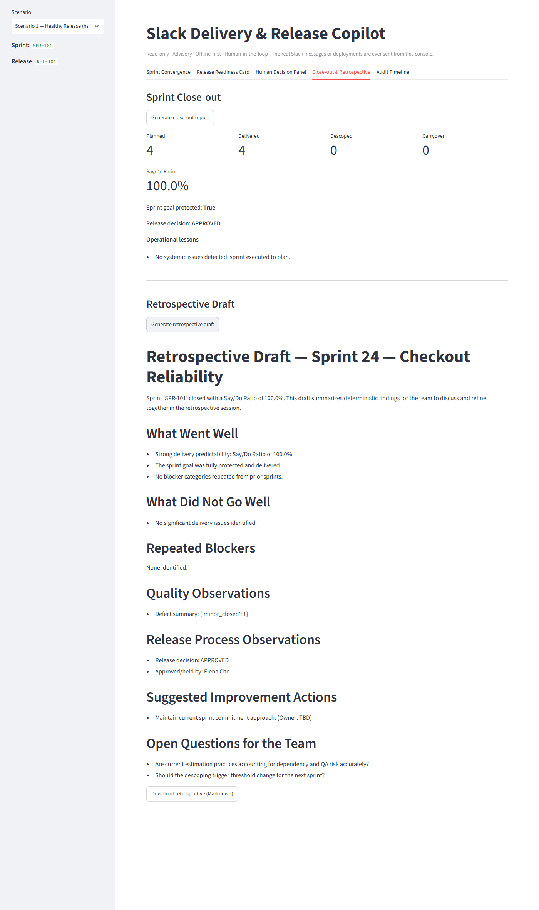
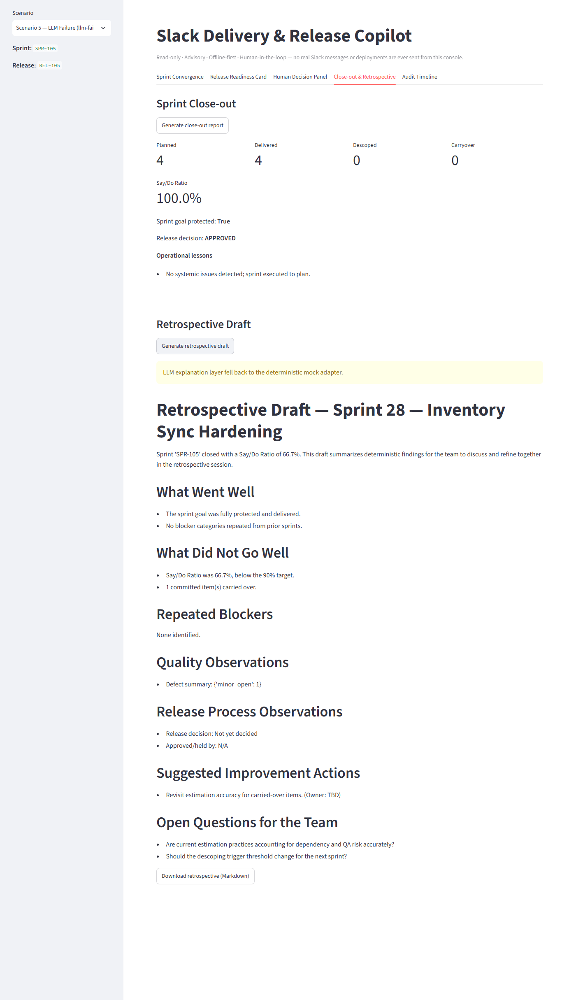

# Demo and Operations

[← Back to README](../README.md)

Everything here runs locally with synthetic data. You don't need any external accounts,
credentials, or network services.

## Installation

Requirements: **Python 3.12+**. Docker with Compose is optional.

```bash
python -m venv .venv
# Windows: .venv\Scripts\activate   |   macOS/Linux: source .venv/bin/activate
pip install -r requirements.txt
python scripts/seed_demo.py
```

`seed_demo.py` is safe to run more than once. It creates the SQLite schema and validates every
scenario file. Scenario data is not copied into the database, because it is always read from
`data/scenarios/` at request time. Expected output:

```text
Database schema initialized (or already up to date).
Validated 5 scenario file(s):
  - healthy-release: Scenario 1 — Healthy Release
  ...
```

## Local startup

Use two terminals with the virtual environment activated:

```bash
uvicorn app.main:app --reload          # terminal 1: API (listens on 127.0.0.1:8000)
streamlit run demo/streamlit_app.py    # terminal 2: demo UI
```

The `Makefile` provides shortcuts: `make install`, `make seed`, `make api`, `make demo`,
`make reset`, `make test`, `make lint`, `make typecheck`. Note that `make api` binds to `0.0.0.0`,
which makes the unauthenticated API reachable from your local network.

| Service | URL |
|---|---|
| API root | http://localhost:8000 |
| Swagger UI | http://localhost:8000/docs |
| ReDoc | http://localhost:8000/redoc |
| Health / readiness / metrics | `/health`, `/ready`, `/metrics` |
| Streamlit demo | http://localhost:8501 |

## Docker startup

```bash
docker compose up --build        # or: make docker-up
docker compose down              # stop; the copilot-data volume (SQLite) is kept
```

Compose builds a single image and runs it as two containers. `copilot-api` serves port 8000.
`copilot-demo` serves port 8501 and starts only after the API healthcheck passes. Inside Compose,
the demo reaches the API at `http://api:8000`, and the database file is `/app/data/copilot.db` on
the named volume `copilot-data`.

To reset demo data inside the container:

```bash
docker compose exec api python scripts/reset_demo.py
```

## Configuration

Copy `.env.example` to `.env` if you want to change anything. None of these settings is needed
for the default offline demo.

| Variable | Default | Used by | Purpose |
|---|---|---|---|
| `DATABASE_URL` | `sqlite:///./data/copilot.db` | API | SQLite location |
| `SCENARIOS_DIR` | `./data/scenarios` | API | Folder containing the scenario JSON files |
| `LLM_MODE` | `mock` | API | `mock` (offline, deterministic) or `openai_compatible` (opt-in) |
| `OPENAI_COMPATIBLE_BASE_URL` / `_API_KEY` / `_MODEL` | empty | API | Read only when `LLM_MODE=openai_compatible`. If any is missing, the mock is used |
| `LOG_LEVEL` | `INFO` | API | Level for the JSON logs |
| `API_HOST`, `API_PORT` | `0.0.0.0`, `8000` | — | Loaded into settings, but the startup commands set the host and port on the `uvicorn` command line |
| `API_BASE_URL` | `http://localhost:8000` | Streamlit | Where the demo UI finds the API. Read from the process environment, not from `.env` |

Never commit a real API key. `.env` is listed in `.gitignore` and `.dockerignore`.

## Demo scenarios

There are five synthetic scenarios in `data/scenarios/`. Pick one from the **Scenario** selector in
the Streamlit sidebar. The five tabs are Sprint Convergence, Release Readiness Card, Human Decision
Panel, Close-out & Retrospective, and Audit Timeline.

The results below were observed when running the local demo:

| Scenario | Convergence | Gate | What to try |
|---|---|---|---|
| **Healthy Release** (`healthy-release`, REL-101) | 100.0, Low | `READY_FOR_HUMAN_APPROVAL` | Evaluate the gate, then approve as Elena Cho / Tech Lead → accepted |
| **Descoping Required** (`descoping-required`, REL-102) | 49.7, High | `NOT_READY` | Generate descoping recommendations: three candidates, two protected items, one for human review |
| **Release Blocked** (`release-blocked`, REL-103) | 38.8, Critical | `HOLD_REQUIRED` | Try to approve → rejected (409). Hold as a Tech Lead → accepted |
| **Unauthorized Approval** (`unauthorized-approval`, REL-104) | 100.0, Low | `READY_FOR_HUMAN_APPROVAL` | Approve as Jordan Blake / Observer → rejected (403) and audited |
| **LLM Failure** (`llm-failure`, REL-105) | 89.6, Low | `NOT_READY` (one item without an approved code review) | Generate the retrospective draft: a fallback warning appears, the draft is still complete, and an `llm_fallback_used` audit event is recorded |

The decision panel uses each scenario's actor list. In every scenario, **Elena Cho** is the Tech
Lead and **Marcus Webb** is the QA Lead. Those are the only roles allowed to decide. Remember to
choose the matching role, because the Role selector starts at "Delivery Manager".

### Walkthrough: healthy release (Scenario 1)

1. On the **Release Readiness Card** tab, click **Evaluate release gate**, then **Load readiness card**.
   All 11 checks pass. The card's Block Kit JSON is displayed collapsed under the version heading.

   
   *Application screenshot (local Streamlit demo, synthetic data): the gate result and the collapsed
   readiness-card payload for v2.9.0.*

2. On **Human Decision Panel**, choose Actor **Elena Cho** and Role **Tech Lead**, then click
   **Approve Deployment**. The decision is recorded. No deployment happens.

   
   *Application screenshot (local Streamlit demo, synthetic data): an authorized approval is accepted
   and recorded.*

3. On **Close-out & Retrospective**, generate the close-out report and the retrospective draft. The
   recorded decision appears in both. You can download the draft as Markdown.

   
   *Application screenshot (local Streamlit demo, synthetic data): 4 planned / 4 delivered, a Say/Do
   Ratio of 100.0%, and a retrospective draft that reflects the APPROVED decision.*

4. On **Audit Timeline**, look over the release's events, newest first.

### Walkthrough: unauthorized approval (Scenario 4)

Evaluate the gate (it returns `READY_FOR_HUMAN_APPROVAL`). Then choose **Jordan Blake / Observer**
and click **Approve Deployment**. The API returns 403, records a rejected decision and an
`approval_rejected` audit event, and the release remains undecided.


*Application screenshot (local Streamlit demo, synthetic data).*

### Walkthrough: LLM failure (Scenario 5)

This scenario sets `force_llm_failure: true`. Generating the retrospective draft triggers the
fallback path. The UI shows a warning, and the deterministic draft is still produced in full.


*Application screenshot (local Streamlit demo, synthetic data): "LLM explanation layer fell back to
the deterministic mock adapter." The rest of the draft is unaffected.*

### Using the API directly

```bash
curl -X POST http://localhost:8000/api/release/evaluate \
  -H "Content-Type: application/json" -d '{"scenario_id": "healthy-release"}'

curl -X POST http://localhost:8000/api/releases/REL-101/decision \
  -H "Content-Type: application/json" \
  -d '{"scenario_id": "healthy-release", "actor": "Elena Cho", "role": "Tech Lead", "decision": "APPROVED"}'

curl http://localhost:8000/api/audit/REL-101
```

### Resetting between runs

Each release accepts only one decision. To repeat a walkthrough, clear all stored state:

```bash
python scripts/reset_demo.py     # or: make reset
```

This drops and recreates the tables (gate evaluations, decisions, audit events, and close-out
reports). The scenario files are not modified.

## Troubleshooting

| Symptom | Cause and fix |
|---|---|
| Demo shows "Could not load scenarios from the API" | The API is not running, or `API_BASE_URL` points to the wrong place. Start the API first and check http://localhost:8000/health |
| Demo pages take many seconds to load on Windows | `localhost` can resolve to IPv6 (`::1`) first. If uvicorn is listening on IPv4 only (the default without `--host`), every request waits for the IPv6 attempt to fail before retrying. Start the demo with `API_BASE_URL=http://127.0.0.1:8000` set in its environment (for example `$env:API_BASE_URL="http://127.0.0.1:8000"` in PowerShell before `streamlit run`) |
| `Decision rejected (409): No release gate evaluation is on record` | Click **Evaluate release gate** before approving. Approval checks the latest recorded gate result |
| `Decision rejected (409): ... approval requires READY_FOR_HUMAN_APPROVAL` | Expected for `NOT_READY` / `HOLD_REQUIRED` releases. An authorized actor can still **Hold** |
| `Decision rejected (409): ... already has a recorded decision` | Only one accepted decision is allowed per release. Run `python scripts/reset_demo.py` to start over |
| `Decision rejected (403): Role ... is not authorized` / `not registered under role` | Only Tech Lead and QA Lead may decide, and the actor must be listed under that exact role in the scenario |
| Empty cells in the Audit Timeline show a dot | Display quirk: the UI writes `-` for empty values and Streamlit renders it as a list bullet. The data itself is unaffected |
| `docker compose build` fails during `pip install` with `SSL: CERTIFICATE_VERIFY_FAILED` | A TLS-inspecting proxy or antivirus is re-signing traffic. Run `powershell -ExecutionPolicy Bypass -File scripts/export_local_ca_cert.ps1` once. It copies the local root CA into the gitignored `docker/extra-ca-certs/`, which the Dockerfile trusts. Then rebuild |
| Build fails at `FROM python:3.12-slim` with `x509: certificate signed by unknown authority` | The same interception, but here it affects the Docker engine's image pull, which happens before the Dockerfile runs, so the script above does not help. Configure Docker to trust your network's root certificate, or build on a network without TLS inspection |
| Port 8000 or 8501 already in use | Stop the other process, or change the published port in `docker-compose.yml` or on the `uvicorn` / `streamlit` command line (and update `API_BASE_URL` to match) |
| A scenario file returns 422 | The JSON is malformed or fails the schema. `python scripts/seed_demo.py` reports which file |

[← Back to README](../README.md)
