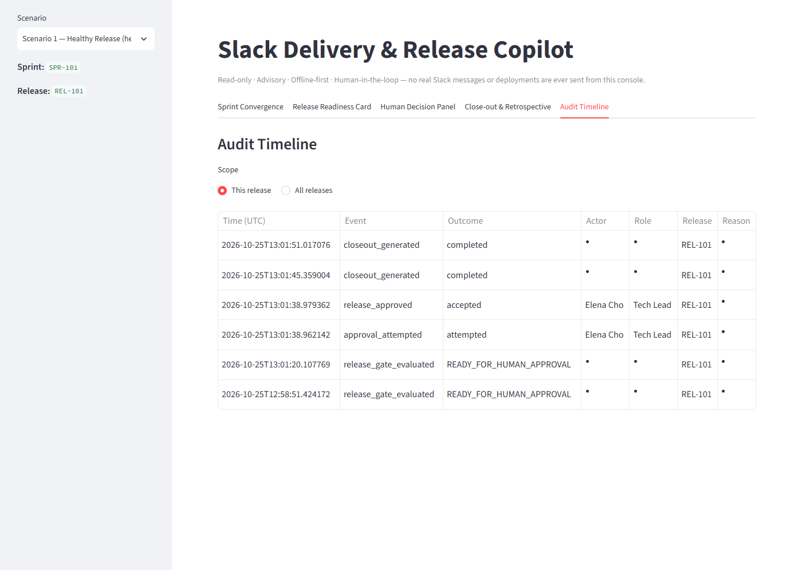

# Governance and Validation

[← Back to README](../README.md)

This document explains where human judgment is required, what the system is and isn't allowed to
do, how data and secrets are handled, how the behavior is tested, and what remains to be built.

## Human oversight

The copilot is a **decision-support tool**. People keep responsibility for every outcome.

| Output | What a human must do |
|---|---|
| Convergence score and risk level | Check them against what the team knows. The score is only as good as the statuses and estimates in the data |
| Descoping recommendations | Accept or reject each one. The engine never changes scope. The outcome is recorded by people in each item's `final_disposition` |
| `Needs Human Review` items | Assess them directly. These are cases where no rule matched confidently |
| Release gate result | Treat it as an evidence check, not a go decision. `READY_FOR_HUMAN_APPROVAL` only means an authorized person *may* now decide |
| Approve / Hold | Done explicitly by a Tech Lead or QA Lead. The system never infers or creates a decision |
| Close-out lessons and retrospective draft | Review them, assign owners (the draft shows "Owner: TBD"), and refine them with the team |
| Optional LLM wording | Read it critically. It may only reword the retrospective introduction |

## Authority boundaries

What the system **can** do:

- Read scenario files, compute scores and recommendations, and evaluate the gate.
- Store gate results, decisions, close-out reports, and audit events in its own SQLite database.
- Build a Slack Block Kit payload for preview.

What the system **cannot** do (none of this exists in the code):

- Change work items, scope, or scenario files. A test checks that descoping never mutates its inputs.
- Deploy, trigger pipelines, or call any CI/CD system.
- Send Slack messages. The mock adapter's `send()` makes no network call, and no endpoint calls it.
- Approve or hold on its own. Every decision comes from an explicit request naming an actor and a role.
- Let an LLM set or change a score, status, or decision. The LLM receives finished facts, and its
  system prompt forbids changing them.

### Approval rules (`app/services/approval_service.py`)

Every attempt is audited first (`approval_attempted`). The attempt is rejected, recorded as a
rejected decision, and audited as `approval_rejected` if any of these apply:

1. The role is not Tech Lead or QA Lead (`unauthorized_role`, 403).
2. The actor is not registered under that exact role in the scenario (`actor_role_mismatch`, 403).
   This stops someone from claiming a role they don't have.
3. The release already has an accepted decision (`duplicate_decision`, 409). Decisions are never
   overwritten.
4. For **Approve** only: no gate evaluation is on record (`no_gate_evaluation`), evidence is missing
   (`missing_evidence`), or the gate is not `READY_FOR_HUMAN_APPROVAL` (`gate_not_ready`). All return 409.

**Hold** is allowed at any gate status, as long as rules 1–3 pass: the actor is authorized and
registered, and the release has no decision yet.

### Audit trail


*Application screenshot (local Streamlit demo, synthetic data): gate evaluations, the approval
attempt, the accepted approval with actor and role, and close-out events for REL-101, newest first.
The retrospective step also generates a close-out report, so `closeout_generated` appears twice.*

- `audit_repo.append_event()` is the only code that writes to the audit table. The application
  never updates or deletes rows, and a unit test checks that no such helpers exist.
- Each event carries a correlation ID. The same ID is returned in the `X-Correlation-ID` response
  header and included in the JSON logs.
- **Limitation:** the append-only rule is enforced by the application, not by the database. Anyone
  with access to the SQLite file can change it, and `scripts/reset_demo.py` deliberately clears it.

## Security and privacy

| Area | Current state |
|---|---|
| Data | Synthetic scenario files only. All names and items are fictional. No production data is used, in the demo or in tests |
| Authentication | **None.** The API is open to anyone who can reach it. Roles are checked against each scenario's actor list, which shows how authorization would work but does not secure the system. Run it only on a trusted local machine |
| Network exposure | The default setup makes no outbound calls. Docker publishes ports 8000 and 8501 on the host, and the Makefile's `api` target binds `0.0.0.0` |
| Secrets | Only the optional LLM key. It is read from the environment or `.env`, which is gitignored and dockerignored. `.env.example` contains empty placeholders |
| LLM data sharing | Only when `LLM_MODE=openai_compatible` is enabled: the sprint ID and Say/Do Ratio are sent to the configured endpoint, along with the API key as a Bearer token. Nothing is sent in mock mode |
| Error handling | Controlled errors return safe messages. Unexpected errors return a generic 500 and log only the exception type. Validation errors don't echo the input back |
| Container | Runs as the non-root user `appuser`. Optional extra root CAs are *added* to the trust store for TLS-inspecting networks. Certificate verification is never disabled |
| Dependencies | Exact versions are pinned in `requirements.txt`. No automated vulnerability scanning is configured |

## Testing

```bash
pytest -q        # 79 tests: unit, integration, end-to-end
ruff check .     # lint (E, F, I, UP, B rules)
mypy app         # type check of the application package
```

Each test runs against a freshly reset temporary SQLite database (`tests/conftest.py`), with
`LLM_MODE=mock` and the real scenario files.

| Suite | Count | Covers |
|---|---|---|
| `tests/unit/` | 57 | Convergence scoring and thresholds, descoping classification and triggers (including no mutation of inputs), every gate check and status precedence (and that the gate never returns "deployed"), close-out math (descoping lowers Say/Do, zero commitments handled), role authorization and role self-assertion, approval state machine (gate not ready, missing evidence, no evaluation, Hold always allowed, no overwriting), audit ordering and filtering, LLM fallback and its audit event |
| `tests/integration/test_api.py` | 17 | Every endpoint through FastAPI's `TestClient`, including 404 and 422 responses and authorized and unauthorized decisions |
| `tests/e2e/` | 5 | One complete workflow for each demo scenario |

**Verified for this documentation:** the full suite passed (79 passed), `ruff check .` reported no
issues, and `mypy app` found no issues in 52 source files. The local demo was run end to end in a
browser to produce the screenshots in these docs. The Docker image build was **not** verified on
the documentation machine, because a TLS-inspecting network blocked the base image pull (see
[troubleshooting](DEMO_AND_OPERATIONS.md#troubleshooting)).

**Not covered by automated tests:** the Streamlit UI, real calls to an OpenAI-compatible endpoint,
the Docker build, and load or concurrency behavior.

## Limitations

- **Proof of concept with synthetic data.** Five hand-built scenarios. There is no import from real
  project or CI tools.
- **No authentication or real identity.** See Security above.
- **Fixed rules.** The weights and thresholds are reasonable defaults, not calibrated against real
  delivery history. They are constants in code, not configuration.
- **Data quality decides the results.** Statuses, estimates, and `final_disposition` values are
  taken as given.
- **Slack is simulated.** The Block Kit card is a preview, and its buttons do nothing.
- **Single-node SQLite.** Not designed for concurrent multi-user use. The audit trail is not
  tamper-proof.
- **One decision per release.** Changing a decision means resetting the demo database. There is no
  amendment or revocation flow.
- **Minor implementation notes:** retrospective drafts always report `llm_enhanced: true`, even in
  mock mode (`llm_fallback_used` is the meaningful flag). The `sprint_id` URL segment on close-out
  and retrospective endpoints is not used to choose data. Code comments in `app/domain/` refer to
  documentation files that no longer exist. The equivalent rules are now in
  [Architecture → Decision rules](ARCHITECTURE.md#decision-rules).

## Future improvements

None of the following is implemented. These are possible next steps:

1. **Real authentication and authorization**, such as SSO/OIDC identities mapped to roles, so that
   approval authority is enforced rather than simulated.
2. **A Slack app integration** that posts the readiness card and handles button interactions,
   verifying Slack request signatures, with the same approval service behind it.
3. **Read-only adapters** for project-management tools (for example Jira, ClickUp, or Monday) and
   for CI/CD status, replacing the scenario JSON as the data source.
4. **Configurable and calibrated rules**, with thresholds set per team based on historical outcomes.
5. **A tamper-evident audit store**, using database-level append-only permissions or hash-chained
   events, plus a production-grade database.
6. **A decision amendment flow** that records a superseding decision instead of requiring a reset.
7. **Automated checks** for the UI and container build in CI, and dependency vulnerability scanning.

[← Back to README](../README.md)
