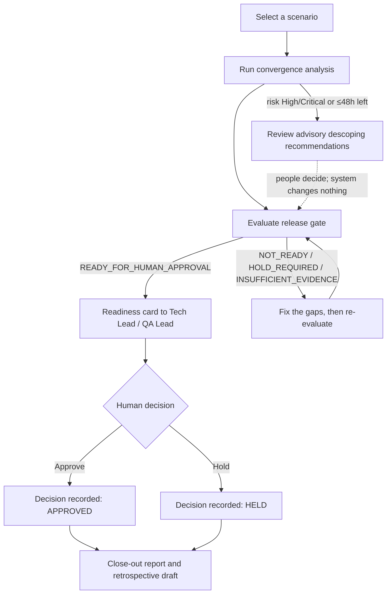
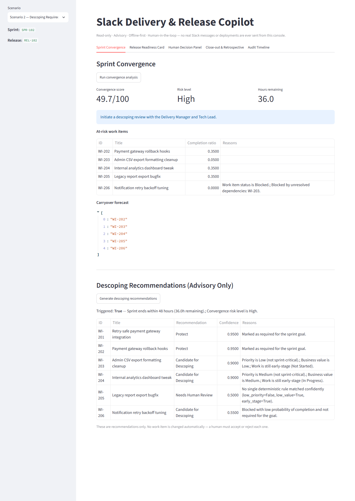
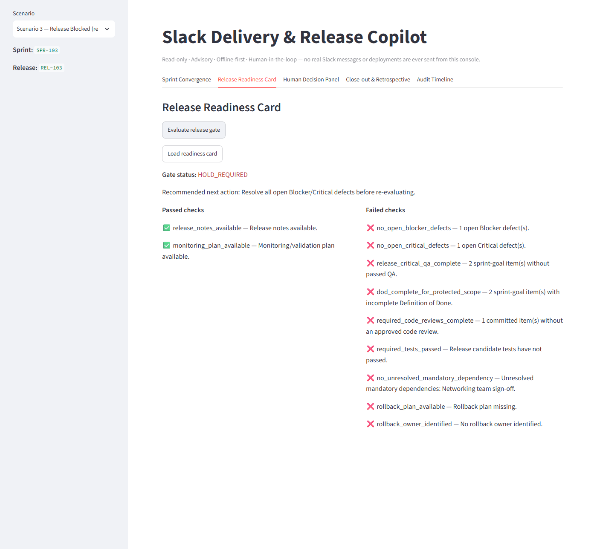

# Project Overview

[← Back to README](../README.md)

## The problem

By the second half of a sprint, the questions about delivery change. Teams stop asking what to
build and start asking whether they will finish safely and whether they should ship. Three
decisions come up again and again under time pressure:

1. **What to descope** so the sprint goal is still met.
2. **Whether the release candidate is safe**: are defects, QA, reviews, tests, and rollback
   arrangements actually in place?
3. **Who decides "go"**, and on what evidence?

These calls are often made informally in a meeting or a direct message. There is no consistent
evidence trail and no record of who decided what. That makes release outcomes hard to reproduce,
review, or improve from one sprint to the next.

## Purpose

The Slack Delivery & Release Copilot is a proof of concept for **process planning and delivery
monitoring** in that final stretch. It reads sprint and release data and produces consistent,
explainable signals for the people who make the decisions. It does not make the decisions itself.

Design principles reflected in the code:

- **Advisory only.** Recommendations are never applied. No work item is changed, no task is closed,
  and nothing is deployed.
- **Deterministic rules.** Every score, status, and authorization check is plain Python with
  documented thresholds (see [Architecture → Decision rules](ARCHITECTURE.md#decision-rules)).
- **Human sign-off.** Only an authorized, registered person can approve or hold a release.
- **Traceable.** Every analysis, gate evaluation, and approval attempt is written to an
  append-only audit trail.
- **Offline by default.** The project uses synthetic scenario files, a mock LLM, and a Slack
  message that is built but never sent.

## Value

| For | What the copilot provides |
|---|---|
| Sprint planning and monitoring | A convergence score, a risk level, the hours remaining, at-risk items, and a carryover forecast |
| Scope discussions | Per-item recommendations (Protect, Candidate for Descoping, Must Hold, Completed, Needs Human Review), each with reasons and a confidence value |
| Release readiness reviews | A gate verdict that lists which of 11 checks passed and failed, plus a recommended next action |
| Release sign-off | An Approve/Hold flow that rejects unauthorized roles, unregistered actors, duplicate decisions, and approvals of releases that are not ready |
| Sprint close-out | Say/Do Ratio, delivered/descoped/carryover counts, defect and blocker summaries, lessons, and a retrospective draft |
| Accountability | A queryable audit timeline per release |

## Capabilities

| Capability | Status | Notes |
|---|---|---|
| Sprint convergence analysis | Implemented | Weighted by priority and business value, with penalties for time, dependency, and defect risk |
| Advisory descoping | Implemented | Triggered when 48 hours or less remain, or when the risk level is High or Critical. Recommendations are always generated |
| Release quality gate | Implemented | Statuses: `READY_FOR_HUMAN_APPROVAL`, `NOT_READY`, `HOLD_REQUIRED`, `INSUFFICIENT_EVIDENCE`. There is no "deployed" status |
| Release Readiness Card | Implemented (preview only) | Returns a Slack Block Kit-compatible JSON payload with Approve/Hold buttons. It is never sent to Slack |
| Human approval and hold | Implemented | Done through the API or the Streamlit panel. Roles come from the scenario data, not from real authentication |
| Sprint close-out report | Implemented | Uses each work item's human-recorded `final_disposition` |
| Retrospective draft | Implemented | All content comes from rules. The LLM layer writes only the opening paragraph |
| LLM explanation layer | Mock by default; real endpoint optional | An OpenAI-compatible endpoint can be enabled, and any failure falls back to the mock |
| Audit trail and metrics | Implemented | SQLite audit table, JSON logs with correlation IDs, Prometheus-format `/metrics` |
| Live Slack, CI/CD, or project-tool integration | Not implemented | Future work. See [Governance and Validation](GOVERNANCE_AND_VALIDATION.md#future-improvements) |

## Workflow

An authorized actor can choose **Hold** at any gate status. **Approve** is accepted only when the
latest recorded gate evaluation is `READY_FOR_HUMAN_APPROVAL`. Each release accepts only one
decision. Later attempts are rejected as duplicates.

## Practical example: a sprint that needs descoping

These figures come from running the local demo with the **Descoping Required** scenario
(`data/scenarios/scenario_2_descoping_required.json`, all data is synthetic).

**1. Monitor convergence.** The simulated time is 36 hours before sprint end. The convergence score
is **49.7/100**, so the risk level is **High**. Five of the six committed items are at risk and in
the carryover forecast. The recommended action is: *"Initiate a descoping review with the Delivery
Manager and Tech Lead."*

**2. Make the risk visible.** Descoping is triggered for two reasons: the sprint ends within 48 hours
(36.0h remaining), and the convergence risk level is High. The engine recommends:

| Item | Recommendation | Confidence | Why |
|---|---|---|---|
| WI-201 Retry-safe payment gateway integration | Protect | 0.95 | Required for the sprint goal |
| WI-202 Payment gateway rollback hooks | Protect | 0.95 | Required for the sprint goal |
| WI-203 Admin CSV export formatting cleanup | Candidate for Descoping | 0.90 | Low priority, low value, not started |
| WI-204 Internal analytics dashboard tweak | Candidate for Descoping | 0.90 | Medium priority, medium value, in progress |
| WI-205 Legacy report export bugfix | Needs Human Review | 0.50 | No rule matched confidently |
| WI-206 Notification retry backoff tuning | Candidate for Descoping | 0.55 | Blocked, low completion probability, not goal-critical |

None of these items is modified. People decide which recommendations to accept, and record the
result in the data as each item's `final_disposition`.

**3. Check release readiness.** The gate returns **`NOT_READY`**. Two sprint-goal items have not
passed QA or completed their Definition of Done, five committed items lack an approved code review,
and the release candidate's tests have not passed. Missing release notes are listed as a warning.
An approval attempt at this point is rejected with HTTP 409.

*Application screenshot (local Streamlit demo, synthetic data): convergence metrics, at-risk items,
carryover forecast, and the advisory descoping table for this example.*

For contrast, the **Release Blocked** scenario shows the strongest stop signal. Open Blocker and
Critical defects make the gate return `HOLD_REQUIRED`, whatever else is in place:

*Application screenshot (local Streamlit demo, synthetic data): 2 checks passed and 9 failed. The
defect checks take precedence, so the recommended next action is to resolve the open
Blocker/Critical defects.*

## Context

This repository is one of three portfolio projects by the same author covering different stages of
the delivery lifecycle (ClickUp, Monday, and Slack themed). Each project runs on its own. This
repository has no integration with the other two.

[← Back to README](../README.md)
